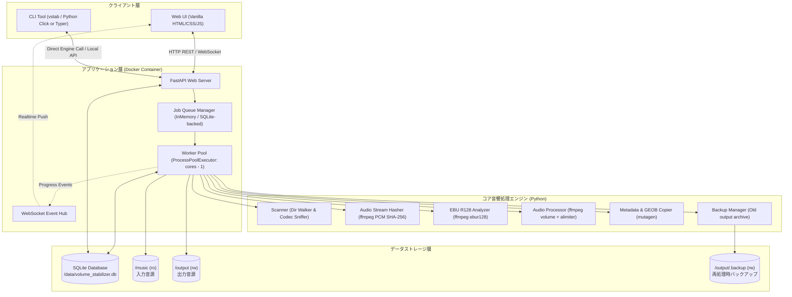
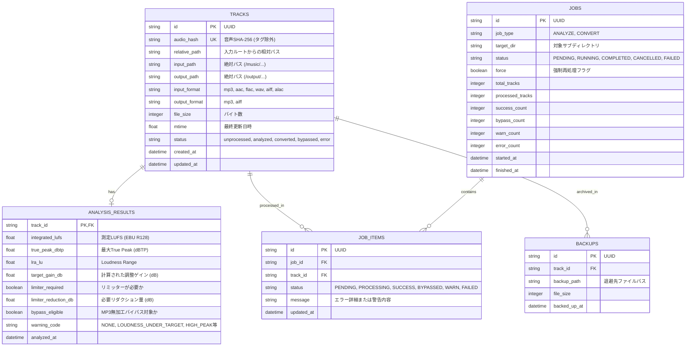

# Volume Stabilizer アーキテクチャ ＆ データ構造設計書

## 1. 全体アーキテクチャ設計

### 1.1 システム構成図


---

## 2. データベース物理設計（SQLite）

SQLite は `/data/volume_stabilizer.db` に永続化されます。WALモード（`PRAGMA journal_mode=WAL;`）を有効化し、並列ワーカーからの読み書きコンフリクトを防止します。

### 2.1 ER図


### 2.2 DDL（テーブル作成定義）
```sql
PRAGMA journal_mode = WAL;
PRAGMA foreign_keys = ON;

CREATE TABLE IF NOT EXISTS tracks (
    id TEXT PRIMARY KEY,
    audio_hash TEXT NOT NULL UNIQUE,
    relative_path TEXT NOT NULL,
    input_path TEXT NOT NULL,
    output_path TEXT NOT NULL,
    input_format TEXT NOT NULL,
    output_format TEXT NOT NULL,
    file_size INTEGER NOT NULL,
    mtime REAL NOT NULL,
    status TEXT NOT NULL DEFAULT 'unprocessed',
    created_at TIMESTAMP DEFAULT CURRENT_TIMESTAMP,
    updated_at TIMESTAMP DEFAULT CURRENT_TIMESTAMP
);

CREATE INDEX IF NOT EXISTS idx_tracks_audio_hash ON tracks(audio_hash);
CREATE INDEX IF NOT EXISTS idx_tracks_relative_path ON tracks(relative_path);
CREATE INDEX IF NOT EXISTS idx_tracks_status ON tracks(status);

CREATE TABLE IF NOT EXISTS analysis_results (
    track_id TEXT PRIMARY KEY,
    integrated_lufs REAL NOT NULL,
    true_peak_dbtp REAL NOT NULL,
    lra_lu REAL NOT NULL,
    target_gain_db REAL NOT NULL,
    limiter_required INTEGER NOT NULL DEFAULT 0,
    limiter_reduction_db REAL NOT NULL DEFAULT 0.0,
    bypass_eligible INTEGER NOT NULL DEFAULT 0,
    warning_code TEXT DEFAULT 'NONE',
    analyzed_at TIMESTAMP DEFAULT CURRENT_TIMESTAMP,
    FOREIGN KEY(track_id) REFERENCES tracks(id) ON DELETE CASCADE
);

CREATE TABLE IF NOT EXISTS jobs (
    id TEXT PRIMARY KEY,
    job_type TEXT NOT NULL,
    target_dir TEXT NOT NULL,
    status TEXT NOT NULL DEFAULT 'PENDING',
    force INTEGER NOT NULL DEFAULT 0,
    total_tracks INTEGER DEFAULT 0,
    processed_tracks INTEGER DEFAULT 0,
    success_count INTEGER DEFAULT 0,
    bypass_count INTEGER DEFAULT 0,
    warn_count INTEGER DEFAULT 0,
    error_count INTEGER DEFAULT 0,
    started_at TIMESTAMP DEFAULT CURRENT_TIMESTAMP,
    finished_at TIMESTAMP
);

CREATE TABLE IF NOT EXISTS job_items (
    id TEXT PRIMARY KEY,
    job_id TEXT NOT NULL,
    track_id TEXT NOT NULL,
    status TEXT NOT NULL DEFAULT 'PENDING',
    message TEXT,
    updated_at TIMESTAMP DEFAULT CURRENT_TIMESTAMP,
    FOREIGN KEY(job_id) REFERENCES jobs(id) ON DELETE CASCADE,
    FOREIGN KEY(track_id) REFERENCES tracks(id) ON DELETE CASCADE
);

CREATE INDEX IF NOT EXISTS idx_job_items_job_id ON job_items(job_id);

CREATE TABLE IF NOT EXISTS backups (
    id TEXT PRIMARY KEY,
    track_id TEXT NOT NULL,
    backup_path TEXT NOT NULL,
    file_size INTEGER NOT NULL,
    backed_up_at TIMESTAMP DEFAULT CURRENT_TIMESTAMP,
    FOREIGN KEY(track_id) REFERENCES tracks(id) ON DELETE CASCADE
);
```

---

## 3. 音声ハッシュ計算ロジック（メタデータ除外）

### 3.1 仕様
ファイルのメタデータ（ID3タグやMP4 atom、アートワーク）が編集された場合でも同一音源として認識するため、**デコード後のRAW PCMオーディオストリームのSHA-256ハッシュ**を算出します。

```python
import hashlib
import subprocess

def compute_audio_hash(file_path: str) -> str:
    """
    ffmpeg を用いて音声を 44.1kHz 16bit ステレオ PCM に標準化してパイプ出力し、
    そのストリームの SHA-256 を計算する。
    これによりヘッダーやタグの差異を完全に排除した音響同一性を担保。
    """
    cmd = [
        "ffmpeg", "-nostats", "-loglevel", "error",
        "-i", file_path,
        "-vn", "-sn", "-dn",              # 映像・字幕・データストリーム除外
        "-f", "s16le", "-ac", "2", "-ar", "44100", # 固定PCMフォーマット
        "-"
    ]
    hasher = hashlib.sha256()
    with subprocess.Popen(cmd, stdout=subprocess.PIPE, stderr=subprocess.PIPE) as proc:
        while True:
            chunk = proc.stdout.read(65536)
            if not chunk:
                break
            hasher.update(chunk)
        proc.wait()
        if proc.returncode != 0:
            raise RuntimeError(f"ffmpeg audio hash error on {file_path}")
    return hasher.hexdigest()
```

---

## 4. REST API 設計仕様

ベースURL: `/api/v1`

| メソッド | パス | 説明 | リクエスト例 / レスポンス例 |
|---|---|---|---|
| `GET` | `/system/status` | システム情報（CPU, 並列数, マウント状況, バージョン） | `{ "workers": 7, "input_root": "/music", "output_root": "/output", "db_tracks": 1420 }` |
| `GET` | `/fs/tree` | `/music` 配下のディレクトリツリー取得 | Query: `?path=House` -> `{ "current": "House", "subdirs": ["Deep", "Tech"], "audio_files_count": 48 }` |
| `POST` | `/jobs/analyze` | 解析ジョブ起動（第1段階） | Body: `{ "target_dir": "House/Tech", "force": false }` -> `{ "job_id": "uuid..." }` |
| `GET` | `/jobs/{job_id}` | ジョブの進行状況および結果概要 | `{ "status": "RUNNING", "progress": 45.2, "processed": 22, "total": 48 }` |
| `GET` | `/jobs/{job_id}/tracks` | ジョブ対象曲の詳細一覧（解析結果付き） | `{ "items": [ { "id": "...", "path": "...", "lufs": -14.2, "gain": 4.2, "limiter_reduction": 1.2, "status": "ANALYZED", "excluded": false } ] }` |
| `PATCH` | `/jobs/{job_id}/tracks/{track_id}` | 曲ごとの除外/包含切り替え | Body: `{ "excluded": true }` -> `{ "success": true }` |
| `POST` | `/jobs/convert` | 変換ジョブ起動（第2段階） | Body: `{ "analyze_job_id": "uuid...", "force": false }` -> `{ "convert_job_id": "uuid..." }` |
| `POST` | `/tracks/{track_id}/reprocess` | 個別曲の強制再処理（--force） | Body: `{}` -> `{ "job_id": "uuid..." }` |
| `GET` | `/reports/export` | 解析・変換結果のCSVエクスポート | Query: `?job_id=uuid...` -> CSVファイルダウンロード |

---

## 5. WebSocket プロトコル仕様

エンドポイント: `/ws/progress`
クライアントは接続後、リアルタイムで進捗イベントおよびログを受信します。

### 5.1 メッセージフォーマット（JSON）
```json
{
  "event": "JOB_PROGRESS",
  "data": {
    "job_id": "c8b6d39a-...",
    "job_type": "CONVERT",
    "total": 120,
    "processed": 64,
    "percent": 53.3,
    "current_track": "House/Tech/Track01.flac",
    "step": "ENCODING",
    "speed": "2.4x"
  }
}
```
イベント種別:
- `JOB_STARTED`: ジョブ開始
- `JOB_PROGRESS`: トラック完了ごとの進捗更新
- `TRACK_LOG`: 個別トラックの処理ログ（警告発生時など）
- `JOB_COMPLETED`: 全トラック完了（サマリー付与）
- `JOB_FAILED`: エラー中断

---

## 6. CLI インターフェース仕様（vstab）

Docker コンテナ内部または `docker compose exec app vstab ...` で呼び出し可能なCLIツール。

```bash
# 1. 音源フォルダの解析（一覧表示）
vstab analyze <target_subpath> [--force] [--json]

# 2. 音源のスタビライズ変換
vstab convert <target_subpath> [--force] [--target-lufs=-10.0] [--workers=N]

# 3. 直近のジョブステータス確認
vstab status [<job_id>]

# 4. 単一ファイルの検査・ハッシュ確認
vstab inspect <file_path>

# 5. 結果レポートのCSV出力
vstab export --job-id=<job_id> --output=report.csv
```
