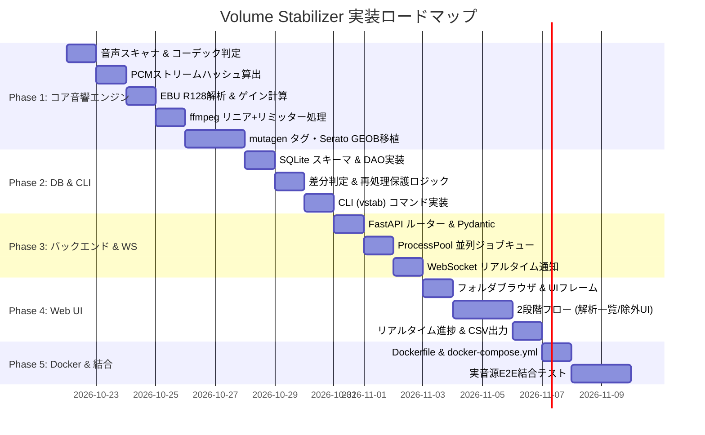

# Volume Stabilizer 実装計画書 (Implementation Plan)

## 1. 開発フェーズ構成とロードマップ

本システムの実装を5つのフェーズに分割し、段階的に検証しながら構築します。

---

## 2. 各フェーズの詳細作業項目

### Phase 1: コア音響エンジン ＆ メタデータ処理（最重要基盤）
- **Task 1.1: 音源スキャナ & フォーマット識別**
  - 入力ディレクトリの再帰的走査（.mp3, .m4a, .wav, .aiff, .flac）。
  - `ffprobe` による正確なコーデック判定（ALAC vs AAC の判別）。
- **Task 1.2: 音声データハッシュ算出器**
  - ffmpeg による 44.1kHz 16bit PCM パイプ出力と SHA-256 ストリーム計算。
  - メタデータ編集前後でハッシュが不変であることを単体テストで検証。
- **Task 1.3: EBU R128 音響解析**
  - `ebur128=peak=true` フィルタの実行と、Integrated LUFS / True Peak / LRA のパース。
  - 目標 -10.0 LUFS に対するゲイン計算と、リミッター必要性（超過分 ≤ 3dB）の判定。
- **Task 1.4: 音響プロセッサ（リニアゲイン ＋ トゥルーピークリミッター）**
  - `volume=<gain>dB` + `alimiter`（オーバーサンプリング内包）の動的フィルタグラフ構築。
  - MP3 320k CBR / AIFF 24bit 48kHz のエンコード処理。
  - MP3無加工バイパス条件（±0.5 LU, TP ≤ -1.0 dBTP）の実装。
- **Task 1.5: メタデータ & Serato GEOB 移植**
  - mutagen を用いた全標準タグ（ID3v2.3/2.4, Vorbis, MP4）の正規化マッピング。
  - Serato `GEOB:Serato Markers2` などのバイナリフレーム抽出と、出力ファイルへの完全コピー。
  - ReplayGain 関連タグ（`REPLAYGAIN_*`, `R128_*`）の自動削除。

### Phase 2: データストレージ ＆ 差分管理 ＆ CLI
- **Task 2.1: SQLite データベースレイヤー**
  - スキーマ定義、WALモード、インデックス作成。
  - `tracks`, `analysis_results`, `jobs`, `job_items`, `backups` の CRUD 操作。
- **Task 2.2: 差分スキップ ＆ 強制再処理（--force）保護**
  - 音声ハッシュに基づく既処理チェック。
  - `--force` 時の既存出力ファイルからのタグ救出および `.backup` ディレクトリへの退避。
- **Task 2.3: CLI ツール `vstab` の実装**
  - `analyze`, `convert`, `status`, `inspect`, `export` サブコマンド。
  - ターミナル用プログレスバー（Rich / tqdm）による直感的なフィードバック。

### Phase 3: Web バックエンド ＆ 並列ジョブキュー
- **Task 3.1: FastAPI REST API**
  - ディレクトリ走査 API、解析・変換ジョブ作成 API、トラック除外設定 API、CSV出力。
- **Task 3.2: 並列ワーカープール**
  - `concurrent.futures.ProcessPoolExecutor` による並列実行（デフォルト: `cores - 1`）。
  - 各ワーカー内での独立した ffmpeg プロセス管理とタイムアウト監視。
- **Task 3.3: WebSocket リアルタイム配信**
  - ジョブ開始、トラックごとの解析・エンコード進捗、完了イベントをブロードキャスト。

### Phase 4: Web UI フロントエンド（Vanilla HTML/CSS/JS）
- **Task 4.1: UIフレームワーク ＆ デザインシステム**
  - ダークモード基調の洗練されたDJ向けUI（サイバー・スリークなカラーパレット）。
  - レスポンシブ対応、直感的なフォルダツリービュー。
- **Task 4.2: 2段階ワークフロー画面**
  - ステップ1: 対象フォルダ選択 ＆ 「解析」実行。
  - ステップ2: 解析結果テーブル表示（曲名、LUFS、True Peak、リミッター要否、ゲイン、警告バッジ）。
  - チェックボックスによる個別除外・全選択。
  - ステップ3: 「変換」実行 ＆ プログレスバー・リアルタイムログ。
- **Task 4.2.1: トラック一覧のタブ分割・処理済み折りたたみ**（仕様書 12章）
  - To Do / Processed タブ、To Do 下部の折りたたみ見出し、Select All の対象範囲制御。
  - 表示件数（10/20/50/100/ALL、既定10、`localStorage` 保存）プルダウンと、一覧下のページャー（先頭/前へ/最大5ページ番号/次へ/末尾）。選択状態はページを跨いで保持（仕様書 12.5 / 12.7）。
  - 分類ロジックを `static/js/track_view.js` に分離し、pytest（V8 バインディング）で単体テスト。
- **Task 4.3: レポート ＆ CSV エクスポート**
  - 変換結果サマリー（成功、バイパス、警告、スキップ数）。
  - ワンクリック CSV ダウンロード機能。

### Phase 5: Docker コンテナ化 ＆ 結合テスト
- **Task 5.1: Dockerfile ＆ docker-compose.yml**
  - 軽量な Python 3.12+ ベースイメージ + 最新 ffmpeg。
  - ボリュームマウント設定（`/music:ro`, `/output:rw`, `/data:rw`）。
- **Task 5.2: E2E テスト ＆ 実機検証**
  - テスト音源（正弦波、ピンクノイズ、実曲サンプル）を用いた完全自動化テスト。
  - Serato DJ / Rekordbox での認識テスト（Cueポイント維持の確認）。

---

## 3. マイルストーンと完了基準 (Acceptance Criteria)

| マイルストーン | 成果物 | 完了基準 |
|---|---|---|
| **M1: 音響・タグ検証** | Phase 1 モジュール群 | 合成音源で -10.0 LUFS (±0.3 LU) に収束すること。Serato Markers2 が MP3/AIFF 出力に正しく保持されること。 |
| **M2: CLI & DB 差分** | Phase 2 `vstab` CLI | 2回目の実行で全ファイルがスキップされること。`--force` でバックアップが作成され出力Cueが維持されること。 |
| **M3: API & キュー** | Phase 3 FastAPI サーバー | 並行リクエスト下で `cores - 1` のプロセスがCPUを効率的に利用し、WSに進捗が流れること。 |
| **M4: Web UI** | Phase 4 Web UI 画面 | ブラウザからフォルダ選択 → 解析 → 確認・除外 → 変換がシームレスに完結すること。 |
| **M5: リリース** | Phase 5 Docker Compose | `docker compose up -d` だけで即座にサービスが立ち上がり、実音源ディレクトリの処理が行えること。 |

---

## 4. リスク管理と対策

1. **大容量・多数ファイル（10,000曲以上）処理時のメモリ枯渇**:
   - *対策*: ディレクトリ走査時はジェネレータで逐次処理し、DBコミットはバッチ単位（100件ごと）で実施。
2. **NAS等のCPU/I/O高負荷によるハングアップ**:
   - *対策*: ワーカー数を環境変数 `VS_WORKERS` で制限可能にし、プロセス優先度（`nice`）を適用。
3. **破損した音源ファイルによるクラッシュ**:
   - *対策*: `ffmpeg` や `mutagen` の例外をトラック単位でキャッチし、ジョブ全体を止めずに `ERROR` ステータスとしてDB記録し処理を継続。
