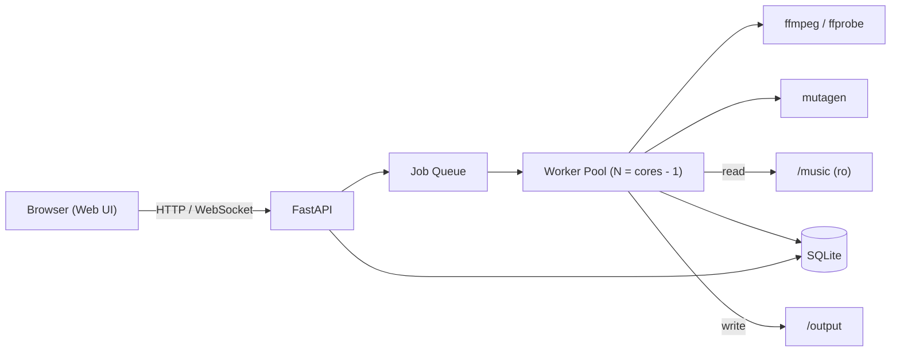

# Volume Stabilizer 仕様書（ドラフト v0.1）

DJ用音源ライブラリのラウドネスを統一する、Docker上で動くWebアプリ。

## 1. 決定事項一覧

| # | 項目 | 決定内容 |
|---|------|----------|
| Q1 | 適用方式 | **別出力**：調整済みファイルを別ディレクトリへ書き出し、元ファイルは変更しない |
| Q2 | 測定基準 | **ラウドネス（LUFS / EBU R128, Integrated）** |
| Q3 | 目標値 | **クラブDJ用途で許容される値** → デフォルト `-9 LUFS`（設定で変更可） |
| Q4 | ピーク超過時 | **トゥルーピークリミッター**で目標値まで持ち上げ（上限 `-1.0 dBTP`） |
| Q5 | 出力形式 | ロッシー入力 → **MP3 320kbps CBR** / ロスレス入力 → **AIFF 24bit / 48kHz** |
| Q6 | メタデータ | **すべて保持**（標準タグ・アートワーク・BPM・Key・Serato等の独自タグ） |
| Q7 | 出力構成 | **入力の階層構造をそのまま再現**（拡張子のみ形式に応じ変更） |
| Q8 | UI | **Web UI**（ローカルサーバー＋ブラウザ） |
| Q9 | 実行環境 | **Docker / docker compose**（ffmpeg同梱） |
| Q10 | 再実行時 | **差分処理**（未変更の処理済み曲はスキップ、解析結果はDBに保存） |
| Q11 | 処理フロー | **2段階**：解析 → 一覧で確認・除外 → 変換 |
| Q12 | ディレクトリ指定 | `/music`（入力）と `/output`（出力）をマウントし、UIのフォルダブラウザで配下を選択 |
| Q13 | 認証 | **なし**（LAN内前提。外部公開時はリバースプロキシで保護） |
| Q14 | 入力形式 | MP3 / AAC(M4A) / WAV / AIFF / FLAC / ALAC |
| Q15 | バックエンド | **Python**（FastAPI + mutagen + ffmpeg） |
| Q16 | 並列数 | 設定可能。デフォルト `CPUコア数 − 1`（最低1） |
| Q17 | 信号処理 | **リニアゲイン ＋ 必要時のみトゥルーピークリミッター** |

## 2. 形式の分類と出力ルール

| 入力 | 分類 | 出力 | 拡張子 |
|------|------|------|--------|
| MP3 | ロッシー | MP3 320kbps CBR | `.mp3` |
| AAC (M4A) | ロッシー | MP3 320kbps CBR | `.mp3` |
| WAV | ロスレス | AIFF 24bit/48kHz | `.aiff` |
| AIFF | ロスレス | AIFF 24bit/48kHz | `.aiff` |
| FLAC | ロスレス | AIFF 24bit/48kHz | `.aiff` |
| ALAC (M4A) | ロスレス | AIFF 24bit/48kHz | `.aiff` |

> [!NOTE]
> `.m4a` は拡張子だけでは AAC / ALAC を判別できないため、`ffprobe` のコーデック情報で分類する。

## 3. 信号処理

1. **解析**：`ffmpeg ebur128`（`peak=true`）で Integrated LUFS・True Peak・LRA を測定
2. **ゲイン算出**：`gain = target_lufs − measured_lufs`
3. **予測ピーク**：`predicted_tp = measured_tp + gain`
4. **適用**：
   - `predicted_tp ≤ -1.0 dBTP` → リニアゲインのみ（`volume=gain dB`）
   - `predicted_tp > -1.0 dBTP` → リニアゲイン＋トゥルーピークリミッター
   - 必要に応じて 4x オーバーサンプリングで処理し、インターサンプルピークを抑制
5. **検証**：出力後に再測定し、目標との誤差（例：±0.5 LU）を超えたら警告

> [!IMPORTANT]
> ffmpeg `loudnorm` のダイナミックモードは使用しない（ブレイク/ドロップの抑揚が変わるため）。

## 4. メタデータ引き継ぎ

- mutagen で元ファイルのタグを読み取り、出力形式のタグ体系へマッピングして書き込む
- 対象：曲名・アーティスト・アルバム・ジャンル・年・トラック番号・コメント・アートワーク・BPM・Key・ReplayGain以外の独自フレーム
- Serato の `GEOB` フレーム（Markers2 / BeatGrid / Autotags 等）は ID3 同士（MP3/AIFF）なら原則そのままコピー
- FLAC(Vorbis Comment) / M4A(MP4 atom) 由来の Serato タグは ID3 GEOB 形式へ変換を試みる（変換不可なら警告）
- 既存の ReplayGain タグは削除（出力時点で値が無効になるため）

> [!WARNING]
> MP3 の再エンコードではエンコーダーディレイ（数ms）によりキュー位置がわずかにずれる可能性がある。LAME の gapless 情報を保持し、検証項目に含める。
> Rekordbox / Traktor のキュー情報はファイルではなく各ソフトのDBに保存されるため、本アプリの対象外。

## 5. システム構成

- **DB**：SQLite（`/data` ボリュームに永続化）
- **進捗通知**：WebSocket（または SSE）で解析・変換の進捗をリアルタイム表示
- **入力マウント**：`/music` は read-only でマウントし、元ファイル保護を保証

## 6. 処理フロー（Web UI）

1. フォルダブラウザで `/music` 配下の対象フォルダを選択
2. **解析**実行 → 全曲の一覧を表示
   - 列：パス / 形式 / LUFS / True Peak / LRA / 予定ゲイン / リミッター要否 / 状態
   - フィルタ・ソート、曲ごとの除外チェック
3. **変換**実行 → 進捗表示、完了後に結果レポート（成功・スキップ・警告・失敗）

## 7. 差分処理

- 各曲を `(相対パス, ファイルサイズ, mtime)` で識別（必要に応じて内容ハッシュ）
- 前回から未変更、かつ目標設定（LUFS/dBTP/出力形式）も同一、かつ出力ファイルが存在 → スキップ
- 設定変更時は該当曲を再処理対象にする

## 8. 設定項目（デフォルト値）

| 項目 | デフォルト | 設定方法 |
|------|-----------|----------|
| 目標ラウドネス | `-9.0 LUFS` | Web UI / 環境変数 |
| True Peak 上限 | `-1.0 dBTP` | Web UI / 環境変数 |
| 並列数 | `cores − 1` | 環境変数 |
| 入力ルート | `/music` | docker-compose |
| 出力ルート | `/output` | docker-compose |
| ポート | `8080` | docker-compose |

## 9. 未決定・要確認事項

- フロントエンド技術（Vanilla JS / React 等）
- 目標値 `-9 LUFS` の妥当性（-8〜-10 の範囲で調整余地あり）
- 出力済みファイルの上書きポリシー（元ファイル削除時に出力も消すか）
- ログ・レポートのエクスポート（CSV等）の要否
