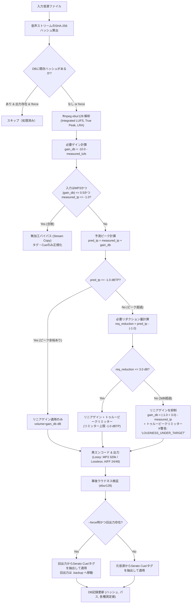

# Volume Stabilizer 仕様書（確定版 v1.0）

## 1. システム概要
**Volume Stabilizer** は、DJがクラブやフェス等の現場で再生する音源ライブラリの体感音量（ラウドネス）を統一するための音響処理・管理システムです。
音源ディレクトリを走査し、EBU R128（Integrated LUFS）に基づく解析を行い、元音源を損なわない別ディレクトリ出力方式でラウドネスを均一化します。Web UI および CLI（コマンドライン）の双方から操作可能であり、Docker コンテナとして提供されます。

---

## 2. 背景と目的
DJプレイにおいて、トラックごとの音量差が大きいと、トランジションごとにミキサーのTRIM/GAINノブで微細な調整を強いられ、イコライジングやエフェクト操作などのクリエイティブなプレイに集中できなくなります。
また、配信サービス向けのマスタリング（-14 LUFS等）とクラブ向けシングル（-8〜-6 LUFS等）が混在していると、著しい音圧の乖離が発生します。
本システムは、**「音源ごとの抑揚・ダイナミクスを殺さず、かつクラブのDJブース・PA環境で違和感のない最適な音量バランス（-10 LUFS）」** に全音源を自動スタビライズすることを目的とします。

---

## 3. 基本方針・設計原則
1. **元音源の不可侵（非破壊）**: 元ファイルは一切改変・削除せず、読み取り専用（read-only）として扱います。
2. **音質最優先の信号処理**: 単純な動的コンプレッション（loudnormの動的モード）は使用せず、リニアゲイン調整と過度なクリッピングを防ぐトゥルーピークリミッター（上限リダクション3.0 dB）の組み合わせのみを使用します。
3. **DJメタデータの完全継承**: 曲名・アーティスト等の一般タグだけでなく、SeratoのGEOB（Cueポイント、Beatgrid等）、BPM、Key情報を可能な限り出力ファイルに移植します。
4. **冪等性と再処理防止**: 音声データ自体のハッシュ（メタデータを除外した音声信号の指紋）により処理済み判定を行い、明示的な `--force` 指示がない限り二重処理を行いません。
5. **DJワークフローとの親和性**: ユーザーは「処理後の出力ファイルに対してCue打ち・プレイリスト作成を行う」前提に立ち、強制再処理時には出力ファイルのタグ・Cueを保護・バックアップします。

---

## 4. 仕様一覧（Q1〜Q24 決定事項）

| # | 項目 | 決定仕様 | 根拠・詳細 |
|---|---|---|---|
| 1 | 音量調整方式 | **別出力方式** | 元ファイルは保持し、指定の出力ディレクトリへ階層構造を維持して別ファイルとして書き出す。 |
| 2 | 音量測定基準 | **EBU R128 (Integrated LUFS)** | 人間の聴覚特性（K-weighting）に合致した体感音量基準を採用。 |
| 3 | 目標ラウドネス | **-10.0 LUFS（固定）** | rekordbox Auto Gain水準（約-10 LUFS）に準拠。ダイナミクスを維持し、クラブPAで十分な解像度を確保。 |
| 4 | ピーク制限 | **トゥルーピーク上限 -1.0 dBTP** | DACでのインターサンプルピーク（ISP）歪みや不可逆圧縮時のクリッピングを防止。 |
| 5 | 出力フォーマット | **ロッシー: MP3 320kbps CBR**<br>**ロスレス: AIFF 24bit / 48kHz** | CDJ/DJ機器との最高互換性と高音質を両立。 |
| 6 | メタデータ | **全メタデータ保持** | Serato GEOB（Cue/Beatgrid）、BPM、Key、アートワーク等。ReplayGainタグのみ削除。 |
| 7 | ディレクトリ構成 | **入力のディレクトリ階層を完全再現** | 入力側のサブフォルダ構造をミラーリング（拡張子のみ変換形式に準拠）。 |
| 8 | 操作UI | **Web UI ＋ CLI のハイブリッド** | ブラウザでの直感操作（フォルダブラウザ、2段階フロー）と、CLI（自動化、cron、`--force`）の双方を同一エンジンで提供。 |
| 9 | 配布・実行環境 | **Docker / Docker Compose** | ffmpeg/mutagen同梱コンテナ。ホスト環境を汚さずNAS/Linux/Mac/Windowsで動作。 |
| 10 | 処理済み判定 | **音声ストリームのSHA-256ハッシュ** | メタデータを除外した純粋な音声ストリームで判定。ファイル名変更やタグ編集に影響されない。 |
| 11 | 画面処理フロー | **2段階方式（解析 → 一覧確認/除外 → 変換）** | 全曲のLUFS/TP/必要ゲインを事前可視化し、除外や調整を行ってから変換を実行。 |
| 12 | パス指定方式 | **`/music` (ro) / `/output` (rw) マウント** | UIのフォルダブラウザで `/music` 配下のサブフォルダを自在に選択可能。 |
| 13 | 認証機能 | **なし（LAN内利用前提）** | ローカルネットワークでの利用。外部公開時はリバースプロキシ（Basic認証/OAuth）で保護。 |
| 14 | 対応入力形式 | **MP3, AAC(M4A), WAV, AIFF, FLAC, ALAC** | DJで用いられる主要全6フォーマットをネイティブサポート。 |
| 15 | バックエンド言語 | **Python (FastAPI + mutagen + ffmpeg)** | Serato GEOBバイナリ解析・移植に最も実績のあるmutagenと高速非同期APIフレームワーク。 |
| 16 | 並列処理数 | **設定可能（デフォルト: `CPUコア数 - 1`）** | NASやサーバーの他タスクへの配慮と高速処理のバランス。最低1。 |
| 17 | 音響信号処理 | **リニアゲイン ＋ 必要時トゥルーピークリミッター** | 曲中の抑揚を崩さない静的ゲイン。ピーク超過時のみ透明性の高いリミッターを適用。 |
| 18 | ラウドネス基準値 | **固定絶対値（-10.0 LUFS）** | ライブラリの平均値ではなく、現場で一貫したゲイン構造となる絶対基準を採用。 |
| 19 | リミッター上限 | **最大ゲインリダクション 3.0 dB** | 3.0 dB以上のリダクションを要する極端に音量の小さい曲は、音質劣化を防ぐため最大3dBで頭打ちし警告フラグを付与。 |
| 20 | 再処理防止基準 | **音声データハッシュ（タグ除外）一致** | 一度変換済みかつハッシュが同一の音源は自動スキップ。 |
| 21 | DJ運用前提 | **出力ファイルに対してCue打ち等を実施** | 出力ファイルをマスターライブラリとして運用。想定課題は明記（第8章）。 |
| 22 | 強制再処理保護 | **出力側タグの引き継ぎ ＆ バックアップ** | `--force` 実行時は既存出力ファイルのCue/タグを新出力へコピーし、旧ファイルはバックアップ退避。 |
| 23 | 強制再処理I/F | **Web UI（曲別/一括再処理） ＋ CLI（`--force`）** | どちらからでも安全な再処理フローを実行可能。 |
| 24 | 目標合致曲の扱い | **MP3無加工バイパス（±0.5 LU, TP ≤ -1.0 dBTP）** | 目標範囲内のMP3は再エンコードによる世代劣化を防ぐためストリームコピー＆タグ正規化。 |

---

## 5. 音響信号処理の詳細アルゴリズム



### 5.1 解析コマンド
```bash
ffmpeg -nostats -i "<INPUT_FILE>" -filter_complex ebur128=peak=true -f null -
```
抽出パラメータ:
- `I`: Integrated Loudness (LUFS)
- `True peak`: Maximum True Peak (dBTP)
- `LRA`: Loudness Range (LU)

### 5.2 ゲインおよびフィルタ構成
- **リニアゲインのみの場合**:
  `-af "volume=<gain_db>dB"`
- **トゥルーピークリミッター適用の場合**:
  `-af "volume=<gain_db>dB,aresample=192000,alimiter=limit=-1.0dB:attack=5:release=50:asc=0:asc_level=1.0,aresample=48000"`
  ※4倍オーバーサンプリング相当の処理によりインターサンプルピークを正確に制御。

---

## 6. フォーマット分類とエンコード仕様

| 入力フォーマット | コーデック判定 | 出力フォーマット | 出力エンコーダ・設定 |
|---|---|---|---|
| MP3 (.mp3) | mp3 | MP3 320kbps CBR (バイパス時は無加工) | `libmp3lame -b:a 320k -id3v2_version 3 -write_id3v1 1` |
| AAC (.m4a, .aac) | aac | MP3 320kbps CBR | `libmp3lame -b:a 320k -id3v2_version 3 -write_id3v1 1` |
| WAV (.wav) | pcm_* | AIFF 24bit / 48kHz | `pcm_s24be -ar 48000` |
| AIFF (.aiff, .aif) | pcm_* | AIFF 24bit / 48kHz | `pcm_s24be -ar 48000` |
| FLAC (.flac) | flac | AIFF 24bit / 48kHz | `pcm_s24be -ar 48000` |
| ALAC (.m4a) | alac | AIFF 24bit / 48kHz | `pcm_s24be -ar 48000` |

---

## 7. メタデータおよびDJ独自タグの保持仕様

### 7.1 対象メタデータ
- **標準タグ**: Title, Artist, Album, AlbumArtist, Genre, Year/Date, TrackNumber, DiscNumber, Comment, Composer
- **DJ固有タグ**:
  - `BPM` (`TBPM` / `tmpo`)
  - `Key` (`TKEY` / `initialkey`)
- **アートワーク**: APICフレーム（フロントカバー、MIMEタイプ、画像バイナリを完全コピー）
- **Serato DJ 独自フレーム**:
  - `GEOB:Serato Markers_`
  - `GEOB:Serato Markers2`（Cueポイント、カラー、ループ情報）
  - `GEOB:Serato Beatgrid`
  - `GEOB:Serato Autotags`
  - `GEOB:Serato Overview`
- **ReplayGainタグ**:
  - `R128_*`, `REPLAYGAIN_*` は出力時に**明示的に削除**（音量変更済みのため誤動作防止）。

---

## 8. DJワークフローにおける想定課題と対策リスト（重要）

ユーザーが「本システムで処理した出力ファイルに対してCue打ち・プレイリスト作成等のDJ作業を行う」運用において、以下の課題が想定されます。

| # | 想定課題 | 影響度 | 原因と詳細 | システム側および運用上の対策 |
|---|---|---|---|---|
| 1 | **MP3再エンコードによるCue微小ズレ** | 中 | MP3エンコーダ特有の「エンコーダーディレイ（先頭・末尾の無音パディング数ミリ秒）」により、波形の時間軸がごくわずかにシフトする。 | ①目標範囲内（±0.5 LU）のMP3は**無加工バイパス**（ディレイゼロ）。<br>②エンコード時はLAMEのgapless情報（Infoタグ）を正確に埋め込み。<br>③運用として「必ずスタビライズ後のファイルに対してDJソフト側でグリッド調整・Cue打ちを行う」ことを徹底。 |
| 2 | **--force 実行時のCue消失リスク** | 高 | DJソフトでCueを打った後の出力ファイルを、設定変更などで再スタビライズすると、Cue情報が消滅する危険。 | ①強制再処理時は既存出力ファイルからID3/GEOBタグを自動抽出し、新生成ファイルにリストア。<br>②上書き前の旧出力ファイルを `.backup/<timestamp>/` に自動退避。 |
| 3 | **RekordboxのCue保存構造の違い** | 高 | Seratoは音源ファイル内のID3タグ（GEOB）にCueを書き込むが、RekordboxはPC本体のローカルDB（master.db）に保存する。 | 出力ファイルパスが変更されるとRekordboxのCueリンクが切れるため、**出力ファイルのパス（階層・ファイル名）は絶対に変えない**（ミラーリング構造を厳格維持）。 |
| 4 | **FLAC/ALACからAIFF変換時のSeratoタグ** | 中 | 元ファイルがFLAC/M4Aの場合、SeratoタグがVorbisCommentやMP4 atom形式で格納されており、AIFF(ID3v2)へ単純移行できない。 | mutagenを用いてVorbisComment/MP4からSerato固有バイナリを抽出し、AIFF内のID3v2.4/2.3 GEOBフレームへと構造変換して埋め込む。 |
| 5 | **ダイナミクスレンジの大きいトラックの違和感** | 低 | アンビエント、クラシック、古いディスコ等で、リミッター上限3dB制限により-10 LUFSに届かない曲が出る。 | システム側で無理に歪ませず、解析一覧で `LOUDNESS_UNDER_TARGET` 警告を表示。DJ側でミキサーのGAINで+2〜3dB補正することを推奨。 |
| 6 | **ストレージ容量の増加** | 中 | 別出力方式であり、ロスレスはAIFF（非圧縮）となるため、FLAC等に比べてファイルサイズが約1.5〜2倍に膨らむ。 | UI上に変換前後の「予測必要ディスク容量」を表示し、出力先ドライブの空き容量を事前チェックする。 |
