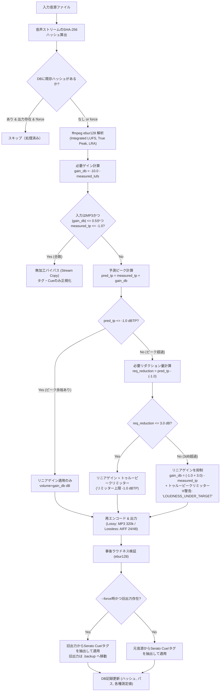

# Volume Stabilizer 仕様書（確定版 v1.0）

## 1. システム概要
**Volume Stabilizer** は、DJがクラブやフェス等の現場で再生する音源ライブラリの体感音量（ラウドネス）を統一するための音響処理・管理システムです。
音源ディレクトリを走査し、EBU R128（Integrated LUFS）に基づく解析を行い、元音源を損なわない別ディレクトリ出力方式でラウドネスを均一化します。Web UI および CLI（コマンドライン）の双方から操作可能であり、Docker コンテナとして提供されます。

---

## 2. 背景と目的
DJプレイにおいて、トラックごとの音量差が大きいと、トランジションごとにミキサーのTRIM/GAINノブで微細な調整を強いられ、イコライジングやエフェクト操作などのクリエイティブなプレイに集中できなくなります。
また、配信サービス向けのマスタリング（-14 LUFS等）とクラブ向けシングル（-8〜-6 LUFS等）が混在していると、著しい音圧の乖離が発生します。
本システムは、**「音源ごとの抑揚・ダイナミクスを殺さず、かつクラブのDJブース・PA環境で違和感のない最適な音量バランス（-10 LUFS）」** に全音源を自動スタビライズすることを目的とします。

---

## 3. 基本方針・設計原則
1. **元音源の不可侵（非破壊）**: 元ファイルは一切改変・削除せず、読み取り専用（read-only）として扱います。
2. **音質最優先の信号処理**: 単純な動的コンプレッション（loudnormの動的モード）は使用せず、リニアゲイン調整と過度なクリッピングを防ぐトゥルーピークリミッター（上限リダクション3.0 dB）の組み合わせのみを使用します。
3. **DJメタデータの完全継承**: 曲名・アーティスト等の一般タグだけでなく、SeratoのGEOB（Cueポイント、Beatgrid等）、BPM、Key情報を可能な限り出力ファイルに移植します。
4. **冪等性と再処理防止**: 音声データ自体のハッシュ（メタデータを除外した音声信号の指紋）により処理済み判定を行い、明示的な `--force` 指示がない限り二重処理を行いません。
5. **DJワークフローとの親和性**: ユーザーは「処理後の出力ファイルに対してCue打ち・プレイリスト作成を行う」前提に立ち、強制再処理時には出力ファイルのタグ・Cueを保護・バックアップします。

---

## 4. 仕様一覧（Q1〜Q24 決定事項）

| # | 項目 | 決定仕様 | 根拠・詳細 |
|---|---|---|---|
| 1 | 音量調整方式 | **別出力方式** | 元ファイルは保持し、指定の出力ディレクトリへ階層構造を維持して別ファイルとして書き出す。 |
| 2 | 音量測定基準 | **EBU R128 (Integrated LUFS)** | 人間の聴覚特性（K-weighting）に合致した体感音量基準を採用。 |
| 3 | 目標ラウドネス | **-10.0 LUFS（固定）** | rekordbox Auto Gain水準（約-10 LUFS）に準拠。ダイナミクスを維持し、クラブPAで十分な解像度を確保。 |
| 4 | ピーク制限 | **トゥルーピーク上限 -1.0 dBTP** | DACでのインターサンプルピーク（ISP）歪みや不可逆圧縮時のクリッピングを防止。 |
| 5 | 出力フォーマット | **ロッシー: MP3 320kbps CBR**<br>**ロスレス: AIFF 24bit / 48kHz** | CDJ/DJ機器との最高互換性と高音質を両立。 |
| 6 | メタデータ | **全メタデータ保持** | Serato GEOB（Cue/Beatgrid）、BPM、Key、アートワーク等。ReplayGainタグのみ削除。 |
| 7 | ディレクトリ構成 | **入力のディレクトリ階層を完全再現** | 入力側のサブフォルダ構造をミラーリング（拡張子のみ変換形式に準拠）。 |
| 8 | 操作UI | **Web UI ＋ CLI のハイブリッド** | ブラウザでの直感操作（フォルダブラウザ、2段階フロー）と、CLI（自動化、cron、`--force`）の双方を同一エンジンで提供。 |
| 9 | 配布・実行環境 | **Docker / Docker Compose** | ffmpeg/mutagen同梱コンテナ。ホスト環境を汚さずNAS/Linux/Mac/Windowsで動作。 |
| 10 | 処理済み判定 | **音声ストリームのSHA-256ハッシュ** | メタデータを除外した純粋な音声ストリームで判定。ファイル名変更やタグ編集に影響されない。 |
| 11 | 画面処理フロー | **2段階方式（解析 → 一覧確認/除外 → 変換）** | 全曲のLUFS/TP/必要ゲインを事前可視化し、除外や調整を行ってから変換を実行。 |
| 12 | パス指定方式 | **`/music` (ro) / `/output` (rw) マウント** | UIのフォルダブラウザで `/music` 配下のサブフォルダを自在に選択可能。 |
| 13 | 認証機能 | **なし（LAN内利用前提）** | ローカルネットワークでの利用。外部公開時はリバースプロキシ（Basic認証/OAuth）で保護。 |
| 14 | 対応入力形式 | **MP3, AAC(M4A), WAV, AIFF, FLAC, ALAC** | DJで用いられる主要全6フォーマットをネイティブサポート。 |
| 15 | バックエンド言語 | **Python (FastAPI + mutagen + ffmpeg)** | Serato GEOBバイナリ解析・移植に最も実績のあるmutagenと高速非同期APIフレームワーク。 |
| 16 | 並列処理数 | **設定可能（デフォルト: `CPUコア数 - 1`）** | NASやサーバーの他タスクへの配慮と高速処理のバランス。最低1。 |
| 17 | 音響信号処理 | **リニアゲイン ＋ 必要時トゥルーピークリミッター** | 曲中の抑揚を崩さない静的ゲイン。ピーク超過時のみ透明性の高いリミッターを適用。 |
| 18 | ラウドネス基準値 | **固定絶対値（-10.0 LUFS）** | ライブラリの平均値ではなく、現場で一貫したゲイン構造となる絶対基準を採用。 |
| 19 | リミッター上限 | **最大ゲインリダクション 3.0 dB** | 3.0 dB以上のリダクションを要する極端に音量の小さい曲は、音質劣化を防ぐため最大3dBで頭打ちし警告フラグを付与。 |
| 20 | 再処理防止基準 | **音声データハッシュ（タグ除外）一致** | 一度変換済みかつハッシュが同一の音源は自動スキップ。 |
| 21 | DJ運用前提 | **出力ファイルに対してCue打ち等を実施** | 出力ファイルをマスターライブラリとして運用。想定課題は明記（第8章）。 |
| 22 | 強制再処理保護 | **出力側タグの引き継ぎ ＆ バックアップ** | `--force` 実行時は既存出力ファイルのCue/タグを新出力へコピーし、旧ファイルはバックアップ退避。 |
| 23 | 強制再処理I/F | **Web UI（曲別/一括再処理） ＋ CLI（`--force`）** | どちらからでも安全な再処理フローを実行可能。 |
| 24 | 目標合致曲の扱い | **MP3無加工バイパス（±0.5 LU, TP ≤ -1.0 dBTP）** | 目標範囲内のMP3は再エンコードによる世代劣化を防ぐためストリームコピー＆タグ正規化。 |

---

## 5. 音響信号処理の詳細アルゴリズム



### 5.1 解析コマンド
```bash
ffmpeg -nostats -i "<INPUT_FILE>" -filter_complex ebur128=peak=true -f null -
```
抽出パラメータ:
- `I`: Integrated Loudness (LUFS)
- `True peak`: Maximum True Peak (dBTP)
- `LRA`: Loudness Range (LU)

### 5.2 ゲインおよびフィルタ構成
- **リニアゲインのみの場合**:
  `-af "volume=<gain_db>dB"`
- **トゥルーピークリミッター適用の場合**:
  `-af "volume=<gain_db>dB,aresample=192000,alimiter=limit=-1.0dB:attack=5:release=50:asc=0:asc_level=1.0,aresample=48000"`
  ※4倍オーバーサンプリング相当の処理によりインターサンプルピークを正確に制御。

---

## 6. フォーマット分類とエンコード仕様

| 入力フォーマット | コーデック判定 | 出力フォーマット | 出力エンコーダ・設定 |
|---|---|---|---|
| MP3 (.mp3) | mp3 | MP3 320kbps CBR (バイパス時は無加工) | `libmp3lame -b:a 320k -id3v2_version 3 -write_id3v1 1` |
| AAC (.m4a, .aac) | aac | MP3 320kbps CBR | `libmp3lame -b:a 320k -id3v2_version 3 -write_id3v1 1` |
| WAV (.wav) | pcm_* | AIFF 24bit / 48kHz | `pcm_s24be -ar 48000` |
| AIFF (.aiff, .aif) | pcm_* | AIFF 24bit / 48kHz | `pcm_s24be -ar 48000` |
| FLAC (.flac) | flac | AIFF 24bit / 48kHz | `pcm_s24be -ar 48000` |
| ALAC (.m4a) | alac | AIFF 24bit / 48kHz | `pcm_s24be -ar 48000` |

---

## 7. メタデータおよびDJ独自タグの保持仕様

### 7.1 対象メタデータ
- **標準タグ**: Title, Artist, Album, AlbumArtist, Genre, Year/Date, TrackNumber, DiscNumber, Comment, Composer
- **DJ固有タグ**:
  - `BPM` (`TBPM` / `tmpo`)
  - `Key` (`TKEY` / `initialkey`)
- **アートワーク**: APICフレーム（フロントカバー、MIMEタイプ、画像バイナリを完全コピー）
- **Serato DJ 独自フレーム**:
  - `GEOB:Serato Markers_`
  - `GEOB:Serato Markers2`（Cueポイント、カラー、ループ情報）
  - `GEOB:Serato Beatgrid`
  - `GEOB:Serato Autotags`
  - `GEOB:Serato Overview`
- **ReplayGainタグ**:
  - `R128_*`, `REPLAYGAIN_*` は出力時に**明示的に削除**（音量変更済みのため誤動作防止）。

---

## 8. DJワークフローにおける想定課題と対策リスト（重要）

ユーザーが「本システムで処理した出力ファイルに対してCue打ち・プレイリスト作成等のDJ作業を行う」運用において、以下の課題が想定されます。

| # | 想定課題 | 影響度 | 原因と詳細 | システム側および運用上の対策 |
|---|---|---|---|---|
| 1 | **MP3再エンコードによるCue微小ズレ** | 中 | MP3エンコーダ特有の「エンコーダーディレイ（先頭・末尾の無音パディング数ミリ秒）」により、波形の時間軸がごくわずかにシフトする。 | ①目標範囲内（±0.5 LU）のMP3は**無加工バイパス**（ディレイゼロ）。<br>②エンコード時はLAMEのgapless情報（Infoタグ）を正確に埋め込み。<br>③運用として「必ずスタビライズ後のファイルに対してDJソフト側でグリッド調整・Cue打ちを行う」ことを徹底。 |
| 2 | **--force 実行時のCue消失リスク** | 高 | DJソフトでCueを打った後の出力ファイルを、設定変更などで再スタビライズすると、Cue情報が消滅する危険。 | ①強制再処理時は既存出力ファイルからID3/GEOBタグを自動抽出し、新生成ファイルにリストア。<br>②上書き前の旧出力ファイルを `.backup/<timestamp>/` に自動退避。 |
| 3 | **RekordboxのCue保存構造の違い** | 高 | Seratoは音源ファイル内のID3タグ（GEOB）にCueを書き込むが、RekordboxはPC本体のローカルDB（master.db）に保存する。 | 出力ファイルパスが変更されるとRekordboxのCueリンクが切れるため、**出力ファイルのパス（階層・ファイル名）は絶対に変えない**（ミラーリング構造を厳格維持）。 |
| 4 | **FLAC/ALACからAIFF変換時のSeratoタグ** | 中 | 元ファイルがFLAC/M4Aの場合、SeratoタグがVorbisCommentやMP4 atom形式で格納されており、AIFF(ID3v2)へ単純移行できない。 | mutagenを用いてVorbisComment/MP4からSerato固有バイナリを抽出し、AIFF内のID3v2.4/2.3 GEOBフレームへと構造変換して埋め込む。 |
| 5 | **ダイナミクスレンジの大きいトラックの違和感** | 低 | アンビエント、クラシック、古いディスコ等で、リミッター上限3dB制限により-10 LUFSに届かない曲が出る。 | システム側で無理に歪ませず、解析一覧で `LOUDNESS_UNDER_TARGET` 警告を表示。DJ側でミキサーのGAINで+2〜3dB補正することを推奨。 |
| 6 | **ストレージ容量の増加** | 中 | 別出力方式であり、ロスレスはAIFF（非圧縮）となるため、FLAC等に比べてファイルサイズが約1.5〜2倍に膨らむ。 | UI上に変換前後の「予測必要ディスク容量」を表示し、出力先ドライブの空き容量を事前チェックする。 |

---

## 9. 大量ファイル走査時のUI応答性・進捗可視化仕様（提案1: A+B+C+D）

大量のファイルや多階層ディレクトリ、NAS（SMB）上のレイテンシ環境において、ユーザーの不安を解消し快適な操作感を担保するための仕様。

### 9.1 非同期スキャンと並行検出（A）
- **非同期走査**: ディレクトリ走査（`rglob`）処理をメインの非同期イベントループから切り離し、バックグラウンドスレッド（`asyncio.to_thread` / `run_in_executor`）で実行。走査中もWeb UIとの通信やステータス取得APIが一切ブロックされない。
- **軽量プレフィルタ**: スキャン段階では重い `ffprobe` プロセス呼び出しを行わず、拡張子チェック（`.mp3`, `.wav`, `.flac`, `.aif`, `.m4a` 等）による超高速走査を実施。詳細なコーデック判定・ロスレス判定は、後続の並列解析ワーカープール（CPU並列）内で実行する。

### 9.2 スキャン進捗イベントの発行と視覚化（B）
- **`JOB_SCANNING` WebSocket イベント**: 走査の進行に伴い、以下のイベントを定期配信（スロットリング間隔: 200〜300ms）。
  - `folders_scanned`: 探索済みディレクトリ数
  - `audio_found`: 検出された音源ファイル数
  - `current_folder`: 現在探索中のフォルダ名
- **UIインジケータ**: プログレスバーにストライプ状の無限ループアニメーション（Indeterminate bar）を適用し、「スキャン中: 24 フォルダ / 1,420 曲検出...」をリアルタイム表示。

### 9.3 即時フィードバックと状態遷移（C）
- **即時レスポンス**: ユーザーが「Analyze Folder」をクリックしたミリ秒単位で、ボタンをローディング表示に切り替え、プログレスカードを `PREPARING` / `SCANNING` 状態で即座に表示。
- **経過時間タイマー**: カード内に経過時間（例: `00:03`）を表示し、システムが停止せず計測・稼働していることを明示。

### 9.4 応答チェックとハートビート警告（D）
- **死活監視（フロントエンド）**: バックエンドからの WebSocket メッセージが 10 秒以上途絶えた場合、プログレスカードに警告文（例: `NAS応答待機中 (最終更新: 12秒前)...`）を表示。
- 遅延（SMB走査の待ち時間）とシステム障害（コンテナ停止やクラッシュ）をユーザーが容易に判別できるようにする。

---

## 10. パス表示およびUIレイアウトのオーバーフロー制御仕様（提案2: A+B+C）

極端に長いファイル名や深いフォルダ階層が存在しても、ブラウザの横幅を固定したままレイアウトが破綻しないようにする仕様。

### 10.1 厳格な幅制限とテキスト省略（A）
- **Flexbox コンテナ制御**: プログレスカード内の要素に `min-width: 0` を付与し、Flexbox 配下でもテキストの `text-overflow: ellipsis; white-space: nowrap; overflow: hidden;` が確実に動作するようにする。
- **Table レイアウト固定**: トラック一覧テーブルに `table-layout: fixed; width: 100%;` を適用。数値列（LUFS, TP, Gain, Status等）の幅を厳格に固定し、相対パス列のみが残余幅を占有して伸縮する構造とする。

### 10.2 ファイル名優先表示と階層のサブ表示（B）
- **2段組レイアウト**: パス表示セルを縦2段に分割：
  - **上段（プライマリ）**: ファイル名（太字、通常色）
  - **下段（セカンダリ）**: ディレクトリパス（フォントサイズ小さめ、薄いグレー色、中間または末尾省略）
- **フルパスツールチップ**: セル全体に `title` 属性を設定し、ホバー時にフルパスがポップアップ表示されるようにする。

### 10.3 選択ディレクトリ基準の短縮相対パス（C）
- **コンテキスト相対表示**: 表内のパスは、ライブラリ全体のルート（`/music`）からではなく、**左ペインで選択されたカレントディレクトリからの相対パス** を優先して表示。
- 例: `/music/Music_Library(STEAM)/1113040_HARDCORE_MECHA_-_OST/disc_1/track.mp3` を選択して解析した場合、表内は `disc_1/track.mp3` と簡潔に表示し、冗長な共通プレフィックスによる圧迫を防ぐ。

---

## 11. スタビライズ処理実績の計上仕様および一覧の処理状態可視化仕様

### 11.1 処理実績（Stabilized）の正確な計上仕様
- **分母表示の廃止と純粋計上**: ヘッダーの `Stabilized:` 表示において、未処理の解析トラック（`status='unprocessed'`）を分母とする分数表記（`0 / 189` 等）を廃止。
- **計上基準**: 実際に音声スタビライズ変換またはバイパス処理が完了したトラック（`status IN ('converted', 'bypassed')`）の実数のみを `Stabilized: X tracks` として計上する。
- **効果**: Analyze（解析）によって未処理データがDBに追加されても、処理実績の数値が混乱を招くことはなく、ユーザーの作業進捗が直感的に把握できる。

### 11.2 ディレクトリ選択時の自動トラック復元仕様
- **課題解消**: Analyze 実行直後やフォルダツリー移動時に、画面のリロードやジョブIDの喪失によってトラック一覧が空（`0 tracks`）になってしまう不具合を防止。
- **自動同期**: 左ペインでディレクトリを選択した際、エンドポイント `/api/v1/tracks?path={subpath}` を介して、当該ディレクトリ配下の登録済みトラック（解析結果・処理ステータス含む）を自動取得・描画する。
- 過去に解析または変換済みのフォルダに戻った場合、再Analyzeを強制されることなく即座に前回の状態（LUFS/Gain/処理状況）が表示され、Step 2（Stabilize）を実行可能とする。

### 11.3 リスト表示における処理済み状態の視覚的識別仕様
- **ステータスバッジの明瞭化**:
  - `✓ Stabilized`（緑色バッジ）: EBU R128 音量均一化エンコード完了
  - `⚡ Bypassed`（シアン色バッジ）: 許容範囲内かつ True Peak 基準を満たしビットパーフェクトコピー完了
  - `Ready`（通常バッジ）: 解析完了・スタビライズ未処理
  - `✕ Error`（赤色バッジ）: 処理エラー
- **行ハイライト（Row Styling）**:
  - 処理済みトラック（Stabilized / Bypassed）のテーブル行に左端グリーンアクセントボーダー（`border-left: 3px solid var(--accent-green)`）および微小な背景ハイライトを付与。
- **スマートチェックボックス選択**:
  - テーブル表示時、**未処理の曲（Ready / Error）のみをデフォルトでチェックON** とし、**処理済みの曲（Stabilized / Bypassed）はデフォルトでチェックOFF** とする。
  - これにより、一部のみ再処理したい場合や、新規追加曲のみを追加変換したい場合の誤操作（二重エンコード）を防止する。
- **内訳サマリー**: テーブル上部の件数表示に `12 tracks (8 Ready, 4 Stabilized)` 等の内訳を表示。

---

## 12. トラック一覧のタブ分割・処理済み折りたたみ仕様（提案: A+B）

処理済みトラックが増えても、次に作業すべき未処理トラックが埋もれないよう、「Track Analysis & Inspection」の一覧を **To Do / Processed の2タブ** に分け、To Do タブ下部に **折りたたみ式の処理済みセクション** を設ける。

### 12.1 トラックの分類
| 分類 | 条件 | 表示先 |
|---|---|---|
| Processed | `status IN ('converted', 'bypassed')` | Processed タブ / To Do タブ下部の折りたたみ |
| To Do | 上記以外（`unprocessed`, `error` 等） | To Do タブ |

- `error` は対処が必要なため To Do に含める。

### 12.2 タブ仕様
- テーブル上部にタブ `To Do (N)` / `Processed (M)` を配置し、各件数を常時表示する。
- **初期表示は To Do タブ**。
- フォルダを移動（左ペインで別ディレクトリを選択）した場合は To Do タブに戻る。同一フォルダ内の再描画（Analyze / Stabilize 完了後など）では現在のタブを維持する。
- 選択中タブの Processed が 0 件になった場合は、To Do タブへ自動的にフォールバックする。

### 12.3 To Do タブ下部の折りたたみセクション（A）
- Processed が 1 件以上あるとき、To Do タブの末尾に見出し行 `Processed: M tracks (X stabilized, Y bypassed)` を表示する。0 件のときは表示しない。
- **既定は折りたたみ**。クリックで、処理済み行を見出し直下に展開する。
- 開閉状態はブラウザの `localStorage`（キー: `vs.processedExpanded`）に保存し、次回アクセス時も維持する。
- 展開された処理済み行のチェックボックスは既定OFF（11.3 と同じ）。
- 展開部に表示する行数は 12.7 の表示件数（上限）に従い、**先頭 N 件のみ**とする。残りがある場合は展開部末尾に「Showing first N of M processed tracks.」と「Open Processed tab」ボタンを表示し、続きは Processed タブ（ページ切り替え可）で確認する。展開部にはページ切り替えを設けない。

### 12.4 空状態
| 条件 | 表示 |
|---|---|
| トラック 0 件 | 「No tracks analyzed in this folder yet. …」（従来どおり） |
| To Do 0 件・Processed 1 件以上 | 「All tracks in this folder are already stabilized.」と、Processed タブへ移動するボタン（自動切替はしない） |
| Processed タブで 0 件 | 12.2 のフォールバックにより発生しない（To Do も 0 件なら上段の表示） |

### 12.5 選択・変換の対象範囲
- 「Select All」（ヘッダーのチェックボックスを含む）は、**表示中ページの主テーブル行のみ**を対象とする。他ページの行や、To Do タブで展開した処理済み行は対象外とする。
- 選択状態は**ページを跨いで保持**する（選択は行ごとに記録し、ページ切り替え・表示件数変更では失われない）。
- 「Stabilize Selected」は、**アクティブなタブの全ページ**から、選択中のトラックすべてを対象とする。
  - To Do タブ: 未処理トラックは既定で選択（ユーザーが外したものを除く）。展開部で明示的にチェックした処理済みトラックも含む。
  - Processed タブ: 明示的にチェックした処理済みトラックのみ（既定は全OFF）。
- チェックが 1 件もない場合の自動選択は **To Do タブのみ**: 未処理行をすべて選択して実行する。Processed タブでは自動選択せず、再処理対象を選ぶよう案内する（「Force Reprocess」の使用を推奨）。
- 選択中の件数を「N selected」として、Select All の横に表示する。
- タブ切り替え・フォルダ移動・解析/変換完了後の再取得時は選択状態を破棄し、各タブの既定値（未処理=ON / 処理済み=OFF）に戻す。

### 12.6 非機能・実装方針
- 分類・タブ構成の決定ロジックは DOM に依存しない純粋関数（`static/js/track_view.js`）に分離し、描画（`app.js`）から利用する。
- バックエンド API の変更は行わない（`/api/v1/tracks` の既存レスポンスをクライアント側で分類する）。

### 12.7 表示件数（上限）とページ切り替え

> 仕様確定時にユーザーへ確認できなかった点は、推奨案（下記）で仮決定している。変更が必要な場合は本節を改定すること。

**表示件数（上限）**
- 1 ページあたりの表示件数を選べるプルダウン（`#page-size-select`）を、「Select All」チェックボックスの隣に配置する。
- 選択肢は **10 / 20 / 50 / 100 / ALL** の 5 段階。**初期値は 10**。
- 選択値はブラウザの `localStorage`（キー: `vs.pageSize`、値: `10` / `20` / `50` / `100` / `all`）に保存し、次回アクセス時も維持する。不正値は 10 に補正する。
- 適用範囲は、To Do タブ・Processed タブ・To Do タブ下部の展開部のすべて共通。
  - To Do / Processed タブ: 1 ページの行数。
  - 展開部: 先頭 N 件のみ表示（12.3）。
- `ALL` を選ぶと全件を 1 ページに表示し、ページャーは表示しない。

**ページャー（一覧の下に配置）**
- 表記: `<< First | < Prev | 1 2 3 4 5 | Next > | Last >>`。
  - ページ番号リンクは、現在ページを中心に**最大 5 ページ分**（先頭・末尾付近では端に寄せて 5 つ）。
  - 現在ページは強調表示（`aria-current="page"`）。
  - 先頭ページでは `<< First` / `< Prev`、末尾ページでは `Next >` / `Last >>` を無効化する。
- 範囲表示: `N–M / 全P件`（例: `11–20 / 57`）をページャーの隣に表示する。
- 総ページ数が 1 以下のときは、ページャー全体を非表示にする。
- ページャーが操作対象とするのは、アクティブなタブの主テーブル行（To Do タブでは未処理行）。展開部は対象外。

**ページ位置のリセット**
- 1 ページ目に戻す: 表示件数の変更、タブ切り替え、フォルダ移動。
- 同一フォルダでの再描画（Analyze / Stabilize 完了後など）では現在ページを維持し、総ページ数を超える場合は最終ページに補正する。

**実装上の取り決め**
- ページ分割・ページ番号計算・選択判定は `track_view.js` の純粋関数（`normalizePageSize` / `pageLinks` / `paginate` / `buildView` / `isSelected` / `collectSelectedIds`）とする。
